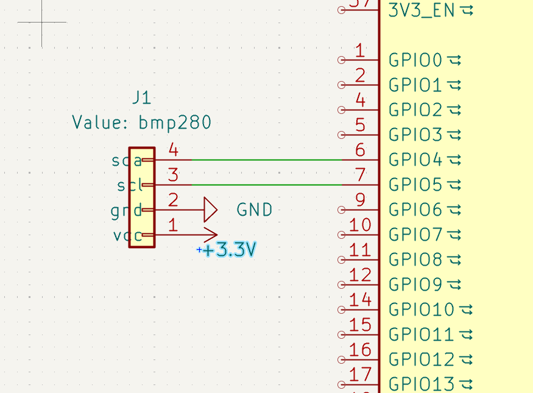
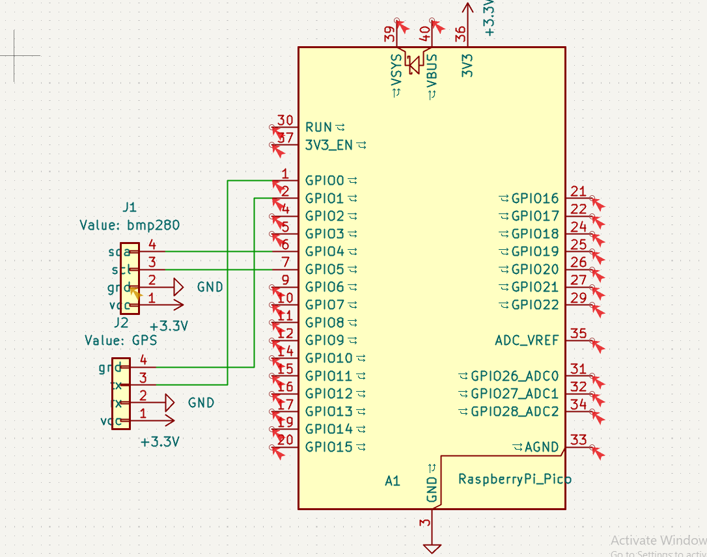
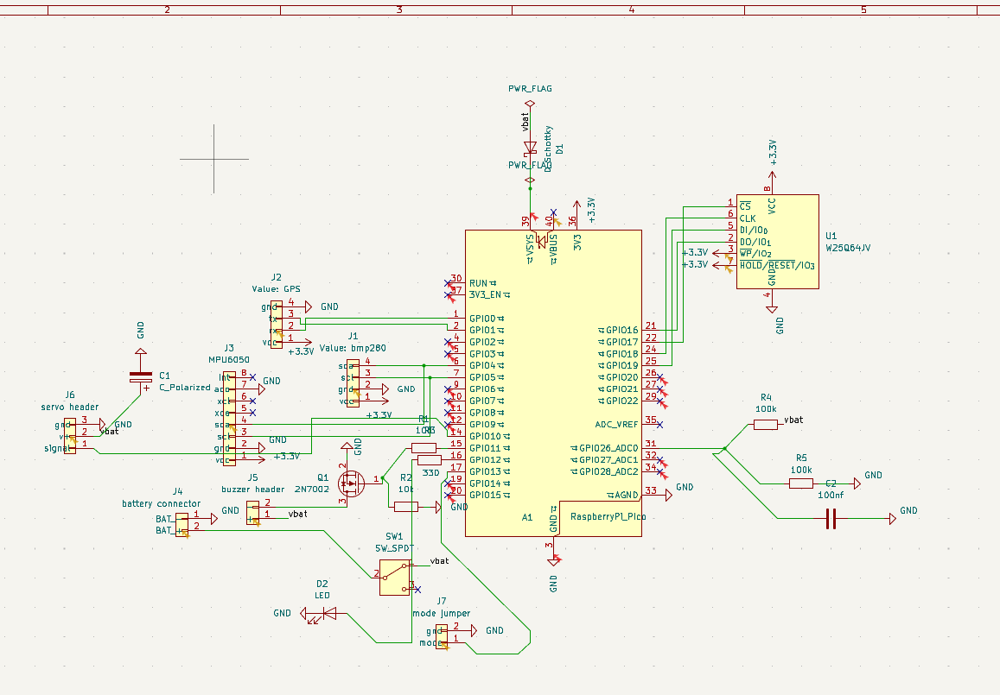

# Skylog-pcb
This is a PCB Im making for my rc plane and rocket! It will track velocity, distance, time, acceleration, gps, have a buzzer and a servo module to release a parachute on apogee!!

I created this for my school club as well, where we test out rc planes and would love to add this addition and teach the cub how to make a pcb. 

I first started with an idea and a name sky logger. I'v always thought about creating pcbs but thought they were to intercate and difficult. I learned that the best way to learn is to do, so instead of watching a youtube video I went right into it, were I succesfully created this amazing pcb, my first ever. I first started with a list of parts that I will probably use. This consisted of a gps, buzzer, led, distance and velocity tracker, esp32 Pico and more. 

## Schmatic 

After grabbing my list of modules that will be useful and that I will need. Then I started placing them, not worrying about connections till after. I changed the pin name and direction and power type, as well as changing my list of materials as I continued. I wired it all up to the espc 32 signal wires as well as connecting all the gnd to gnd. I then also made my VCC 5.5vb connect to the other 5.5v same with 3v

## PCB !!!!

After I set my footpringts and got ran ERC to make sure all the connections were right and that they were no errors, I started on my PCB. First I started by creating a rectangular area to put my all my modules in, after I did that, I looked at the ghost lines and tried my best to put the modules in the best postioton so that's its the most direct way and least complicated way to wire. I stared wiring modules together, but then ran into an issue. No matter what I tried, I could not connect the gnd all to together, after about an hour or so I went to do some research and found out I can just make a whole copper layer just for the GND which helped so much and made the wiring a lot less messier. I also had to take into account the fact that the modules as well take place, so I make sure to give each pin module a good distance away from each other to make sure everything fits. After wiring everything and making sure they were no errors with the DRC, I started with the PCB art. For this, I used Claude AI which gave me some really good generative designs for the backpalte. All I did was input these into Ki KAD and it looked amazing. I did one last check of DRC, wiring, the 3d model to make sure that nothing was wrong before uploading the files

## Cost (AliExpress order)

For the materials, I did my best to go the cheapest route (AliExpress) and spent alot of time to find some cheap but good modules. There are alot of bulk packs because They usualy sell really cheap parts in bulk of 20-50 and you cant just buy your exact amount. I checked with PCB fabricators in the UAE but was not able to receive an email back or find a price. I sellted on JLCBWAY, which is onyl around 24 USD with shipping, as you get a 10 dollar ish discount first time. I chose the cheapest shipping as well, and its suppose to come in 1-2 weeks of ordering.
| Name | Quantity | Unit Price (USD) | Total (USD) | Price (AED) | Link | Notes |
|---|---:|---:|---:|---:|---|---|
| Raspberry Pi Pico (RP2040, with headers) | 1 | 16.17 | 16.17 | 59.38 | [AliExpress](https://www.aliexpress.com/item/1005008058623788.html) | Main controller (A1) |
| GPS module GY-NEO6MV2 | 1 | 12.62 | 12.62 | 46.34 | [AliExpress](https://www.aliexpress.com/item/1005006153090346.html) | Position logging, plane only |
| W25Q64JVSSIQ SPI flash, SOIC-8 | 1 | 6.73 | 6.73 | 24.71 | [AliExpress](https://www.aliexpress.com/item/1005011573616561.html) | Flight data storage (U1); pack of 5 |
| Active buzzer TMB12A | 1 | 2.54 | 2.54 | 9.31 | [AliExpress](https://www.aliexpress.com/item/1005013110978481.html) | Recovery beeper (via Q1); pack of 10 |
| 1N5819HW Schottky diode, SOD-123 | 1 | 2.49 | 2.49 | 9.16 | [AliExpress](https://www.aliexpress.com/item/1005009499190440.html) | Power protection (D1); pack of 50 |
| Ceramic capacitor 100nF | 1 | 2.71 | 2.71 | 9.96 | [AliExpress](https://www.aliexpress.com/item/1005011747293156.html) | Decoupling (C2, C3); pack of 100 |
| Electrolytic capacitor 100uF | 1 | 2.02 | 2.02 | 7.42 | [AliExpress](https://www.aliexpress.com/item/1005011811368397.html) | Power smoothing (C1) |
| 2N7002 MOSFET, SOT-23 | 1 | 2.18 | 2.18 | 8.01 | [AliExpress](https://www.aliexpress.com/item/1005010446312149.html) | Buzzer switch (Q1); pack of 50 |
| SS12D00G4 slide switch | 1 | 2.32 | 2.32 | 8.52 | [AliExpress](https://www.aliexpress.com/item/1005012453860112.html) | Power switch (SW1); pack of 20 |
| BMP280 pressure sensor module 3.3V | 1 | 1.98 | 1.98 | 7.26 | [AliExpress](https://www.aliexpress.com/item/1005007306812689.html) | Altitude (J1) |
| GY-521 MPU6050 IMU module | 1 | 1.75 | 1.75 | 6.43 | [AliExpress](https://www.aliexpress.com/item/1005007989748804.html) | Motion sensing (J3) |
| Female pin header 2.54mm 1x__ | 1 | 2.19 | 2.19 | 8.06 | [AliExpress](https://www.aliexpress.com/item/1005012352493805.html) | Sensor and module sockets; pack of 10 |
| Female pin header 2.54mm 1x__ | 1 | 1.13 | 1.13 | 4.16 | [AliExpress](https://www.aliexpress.com/item/1005012352493805.html) | Sensor and module sockets; pack of 10 |
| Female pin header 2.54mm 1x__ | 1 | 2.14 | 2.14 | 7.85 | [AliExpress](https://www.aliexpress.com/item/1005012352493805.html) | Sensor and module sockets; pack of 10 |
| Female pin header 2.54mm 1x20 | 1 | 1.51 | 1.51 | 5.56 | [AliExpress](https://www.aliexpress.com/item/1005012940352449.html) | Pico sockets (A1); pack of 10 |
| Jumper shunt 2.54mm | 1 | 1.32 | 1.32 | 4.84 | [AliExpress](https://www.aliexpress.com/item/1005010500957186.html) | Mode jumper (J7); pack of 100 |
| Shipping | 1 | 6.74 | 6.74 | 24.77 |  | AliExpress shipping |
| Other (tax / fees) | 1 | 0.27 | 0.27 | 0.98 |  | Difference to order total |

   Full BOM with prices: [bom/bom.csv](Bom/bom.csv)
   

