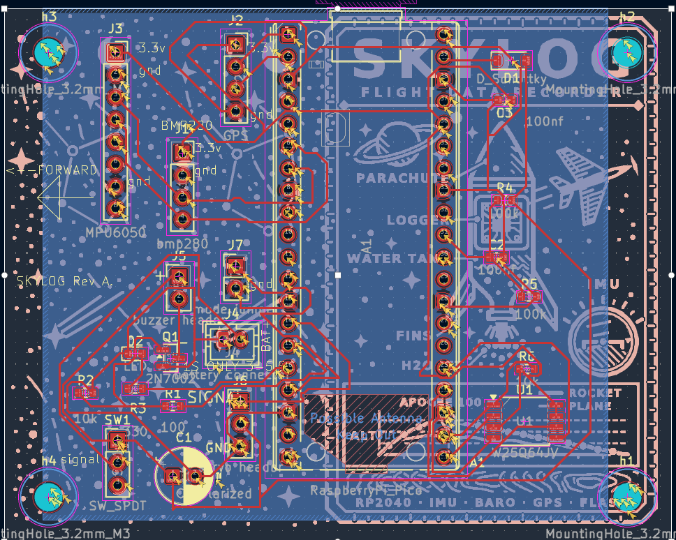
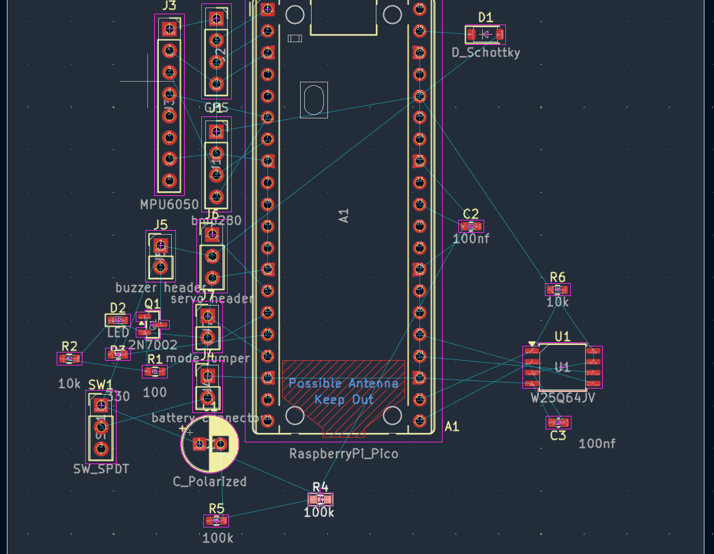

# Skylog-pcb
This is a PCB Im making for my rc plane and rocket! It will track velocity, distance, time, acceleration, gps, have a buzzer and a servo module to release a parachute on apogee!!

I created this for my school club as well, where we test out rc planes and would love to add this addition and teach the cub how to make a pcb. 

I first started with an idea and a name sky logger. I'v always thought about creating pcbs but thought they were to intercate and difficult. I learned that the best way to learn is to do, so instead of watching a youtube video I went right into it, were I succesfully created this amazing pcb, my first ever. I first started with a list of parts that I will probably use. This consisted of a gps, buzzer, led, distance and velocity tracker, esp32 Pico and more. 

S
## PCB images!!!!

## Cost (AliExpress order)

Prices in AED. USD at the fixed rate of 3.6725 AED per 1 USD.

| # | Part | Used for | Pack | AED | USD |
|---|------|----------|------|----:|----:|
| 1 | Raspberry Pi Pico (RP2040, with headers) | Main controller (A1) | 1 | 59.38 | 16.17 |
| 2 | GPS module GY-NEO6MV2 | Position logging (plane) | 1 | 46.34 | 12.62 |
| 3 | W25Q64JVSSIQ SPI flash, SOIC-8 | Flight data storage (U1) | 5 | 24.71 | 6.73 |
| 4 | Active buzzer TMB12A | Recovery beeper (via Q1) | 10 | 9.31 | 2.54 |
| 5 | 1N5819HW Schottky diode, SOD-123 | Power protection (D1) | 50 | 9.16 | 2.49 |
| 6 | Ceramic capacitor, 100 nF | Decoupling (C2, C3) | 100 | 9.96 | 2.71 |
| 7 | Electrolytic capacitor, 100 uF | Power smoothing (C1) | 1 | 7.42 | 2.02 |
| 8 | 2N7002 MOSFET, SOT-23 | Buzzer switch (Q1) | 50 | 8.01 | 2.18 |
| 9 | SS12D00G4 slide switch | Power switch (SW1) | 20 | 8.52 | 2.32 |
| 10 | BMP280 pressure sensor module, 3.3 V | Altitude (J1) | 1 | 7.26 | 1.98 |
| 11 | GY-521 MPU6050 IMU module | Motion sensing (J3) | 1 | 6.43 | 1.75 |
| 12 | Female pin header 2.54 mm, 1x__ | Sensor and module sockets | 10 | 8.06 | 2.19 |
| 13 | Female pin header 2.54 mm, 1x__ | Sensor and module sockets | 10 | 4.16 | 1.13 |
| 14 | Female pin header 2.54 mm, 1x__ | Sensor and module sockets | 10 | 7.85 | 2.14 |
| 15 | Female pin header 2.54 mm, 1x20 | Pico sockets (A1) | 10 | 5.56 | 1.51 |
| 16 | Jumper shunt, 2.54 mm | Mode jumper (J7) | 100 | 4.84 | 1.32 |
| | **Parts subtotal** | | | **226.97** | **61.80** |
| | Shipping | | | 24.77 | 6.74 |
| | Other (tax / fees) | | | 0.98 | 0.27 |
| | **Order total** | | | **252.72** | **68.81** |

